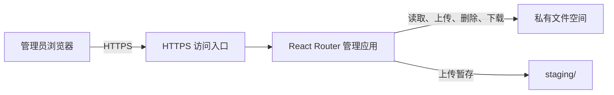
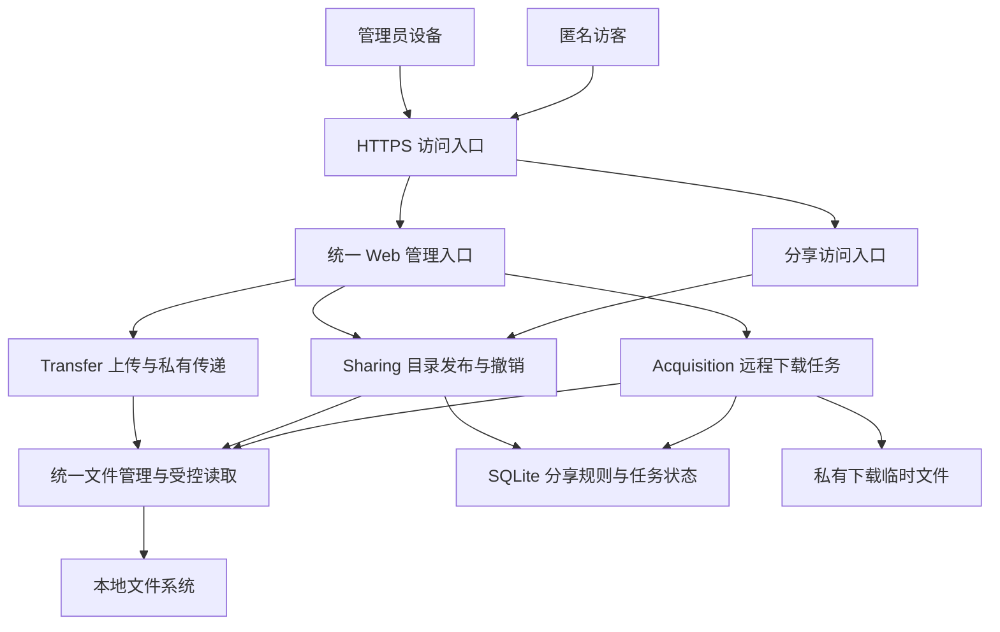

# ShareBox 架构设计

## 1. 设计范围

本文第 2–6 节描述 [当前版本需求](requirements.md#2-当前版本) 的实现，第 7 节描述已确定方向、尚未实现的目标架构。SQLite 与单文件分享后端已实现；分享管理界面与文件操作联动已实现，目录发布、匿名目录浏览与子文件下载已实现，远程下载任务尚未实现。

当前版本由一个 React Router Framework 应用和本地文件系统组成，HTTPS 访问由部署环境提供。管理员首次启动时自动创建，会话存入签名 Cookie；使用 SQLite + Drizzle + better-sqlite3 保存管理员凭据与分享规则，不使用独立 API 服务或任务队列。

## 2. 组件职责

| 组件 | 职责 |
| --- | --- |
| HTTPS 访问入口 | 提供 HTTPS 访问并把请求交给应用 |
| React Router Framework 应用 | 渲染管理界面，读取、上传、删除文件与流式下载 |
| 本地文件系统 | 保存私有文件，并作为文件列表的唯一数据来源 |

管理应用使用 Node.js 和 TypeScript，界面使用 React Router Framework 与 MUI。应用保留服务端运行时和 SSR，服务端 `loader` 读取私有文件列表，独立资源路由的 `action` 处理新建文件夹、文件删除、重命名和上传，下载资源路由返回文件内容。

## 3. 路由和请求处理

管理页面路由 `/`：

- `loader` 递归读取私有根目录中的文件和目录，返回文件名、相对路径、文件大小和子节点。
- 页面使用 MUI 目录列表、面包屑、筛选与排序、文件选择和拖放区域。列表工具栏提供上传文件和新建文件夹；文件行的 ⋯ 菜单提供下载、分享、复制文本、重命名、移动、复制和删除，目录行提供分享、重命名、移动、复制和删除。
- 文件操作使用独立资源路由：`POST /files/remove`、`POST /files/rename` 、`POST /files/mkdir`、`POST /files/move` 和 `POST /files/copy`，由页面按钮通过 fetcher 显式指定 action 提交。
- 操作成功后由 React Router 重新验证 loader，刷新文件列表。

上传组件使用 `tus-js-client`，每个 PATCH 最多 8 MiB，同时传输最多 2 个文件。资源路由 `/uploads/*` 转交 `@tus/server.handleWeb`，POST 创建任务，HEAD 查询已落盘偏移，PATCH 续传，DELETE 终止。全部在管理端同源认证边界内，不提供跨源客户端支持。`UploadService` 通过 `onUploadFinish` 在成功响应前完成落盘；前端仅在 tus `onSuccess` 后调用 revalidator，不再发送独立的 complete 请求。浏览器保存任务元数据，不保存文件内容，刷新后重新选择原文件即可恢复。字节进度到 100% 但响应尚未返回时显示“正在完成”；旧的 publishing/transferred 本地记录恢复为普通暂停任务。

删除使用 POST `/files/remove` 提交相对路径 `path`，重命名使用 POST `/files/rename` 提交相对路径 `path` 和新名称 `newName`。确认后才提交，取消保持文件不变。操作成功后由 React Router 重新验证 loader。新建文件夹使用 POST `/files/mkdir` 提交父目录 `path`（空字符串为根目录）和名称 `name`；校验认证、同源请求、安全名称、父目录和符号链接，使用非递归 mkdir 创建 0700 私有目录，同名文件或目录直接拒绝。

## 4. 文件存储

`STATE_DIR` 可选，用于覆盖唯一的状态根目录；未设置或为空时，通过 `platformdirs.userDataDir("sharebox", false)` 使用当前用户的平台默认数据路径，不带版本子目录。程序在启动时创建和检查内部目录。Docker 镜像显式设置 `/var/lib/sharebox` 并挂载整个根目录：

| 目录示例 | 用途 |
| --- | --- |
| `/var/lib/sharebox/files` | 私有的完整文件，只有认证后的应用能读取 |
| `/var/lib/sharebox/staging` | 上传中的临时数据和完成回执，不对外提供 |

私有根目录允许多级目录和普通文件。loader 忽略符号链接和特殊文件；删除拒绝路径穿越、符号链接和非空目录。上传写入当前浏览的目录，不接收整个目录上传。页面共享当前目录，任务入队时将目标目录与文件信息一起持久化；切换目录不会改变已有任务。tus metadata 的 directory 保存根目录内的相对目录，旧任务未设置时使用根目录。创建任务和完成落盘时均逐级校验目标目录、拒绝越界和符号链接；完成回执保存目标目录以支持重启后恢复，目标不存在时保留暂存并报告错误。

### 上传流程

1. 上传路由先验证管理员会话，应用继续验证来源、文件名和声明大小。
2. FileStore 在 `STATE_DIR/staging/tus` 保存随机 ID 命名的数据和 JSON 元数据。PATCH 流式追加；偏移不一致返回 409，客户端 HEAD 后重试。
3. 前端显示发送进度，暂停通过 abort 终止当前请求但保留任务。恢复时以服务器磁盘偏移为准。删除上传调用 tus DELETE，服务端清理数据与元数据。
4. 最后一次 PATCH（零字节文件为创建 POST）调用 `onUploadFinish`。钩子重新获取与 tus 共用的任务锁，检查实际长度，执行 `copyFile(COPYFILE_EXCL)` 复制到 `files/`，禁止覆盖。钩子返回前不向客户端确认成功。
5. 落盘成功后在 `STATE_DIR/staging/tus-receipts` 保存包含文件名和大小的小型完成回执（先写临时记录再重命名）。等 tus 请求处理结束后清理临时数据，避免零字节 POST 的后续读取失败。HEAD 在返回前检查完成状态：已传完但尚未落盘时自动重试完成处理，失败返回错误且不返回完成偏移；存在回执时即使源文件已清理也返回完成偏移，支持重启及最后响应丢失后的恢复。客户端拦截非 404/410 的 HEAD 错误，防止 tus 自动另建任务。
6. 上传任务从创建起保留 7 天，首次访问及之后每小时清理，清理跳过正在持锁或正在创建的任务。回执从写入起保留 7 天。来源、路径、元数据、回执校验以及过期判断和响应头转换由类外纯函数完成（时间显式传入）；目录准备、复制和回执读写由类外无实例状态的 I/O 函数完成，调用位置仍受共享锁保护。服务实例持有 FileStore、Server、共享锁及定时器；清理任务不重叠执行，`dispose()` 释放定时器并等待清理结束。初始化失败会清空失败的 Promise，允许下次请求重试。只支持单个 Node 进程，进程内锁不能用于多实例共享目录。

落盘继续沿用非原子契约：复制期间 `files/` 中的文件可能不完整，强制终止可能留下残缺文件；复制成功但回执落盘前崩溃时，重试会报告同名冲突，需人工核对。没有整文件哈希校验。短块请求避免整个大文件共用 5 分钟接收窗口，但每个请求仍受 Node/代理超时约束，中断可续传。

### 删除、重命名与转移流程

1. `/files/remove`、`/files/rename` 资源路由验证管理员会话后处理各自表单。
2. 路由在认证后校验 POST 方法、请求来源和表单，准备操作上下文，然后直接调用对应的删除或重命名 handler；handler 校验相对路径，逐级检查目标位于私有根目录内且不是符号链接。删除允许普通文件或空目录，重命名拒绝路径分隔符和空名称。
3. 删除目标文件或空目录、或重命名目标后返回结果，React Router 随后刷新列表。

移动及复制由 `transfer-action.server.ts` 校验表单、记录开始/结果日志，由 `files/transfer.server.ts` 处理文件系统操作。目标使用 `destination` 相对目录（空为根），拒绝源目录、子目录、当前父目录和同名目标；所有路径检查拒绝穿越及符号链接。文件移动使用排他硬链接再删除源，失败回滚新链接，保持 inode 与分享身份；目录移动先排他创建空目标占位，再 rename，失败清理占位。同文件系统移动返回路径变更并沿用分享同步，跨文件系统移动报错。复制逐级使用排他 mkdir / COPYFILE_EXCL，拒绝符号链接和特殊文件，出错清理本次创建的目录副本；复制不产生分享变更。复制过程可见，进程强制终止可能留下不完整副本，目录移动中断可能留下空占位目录。

资源路由 `/download` 调用 `deliverFile`，逐级检查路径和符号链接，以 `O_NOFOLLOW` 打开普通文件，通过文件句柄流式读取，设置附件文件名、长度、Last-Modified 和 Accept-Ranges。支持单段、开放尾端和后缀 Range；不可满足的范围返回 416，多段范围退回完整响应；If-Range 日期不匹配时返回完整内容。HEAD 和空文件不创建数据流。请求取消及流关闭释放文件句柄；请求边界与传输错误记录日志。与既有文件操作相同，路径检查与打开之间仍存在并发替换父目录的竞态，不能作为针对本机恶意目录修改者的文件系统沙箱。

`auth.server.ts` 复用 React Router Cookie Session Storage，签名 Cookie 保存管理员标识、到期时间和凭据版本。`password.server.ts` 使用 Node 异步 scrypt（N=16384、r=8、p=1），哈希保存随机盐及派生密钥，校验使用 timingSafeEqual。管理 loader/action、下载和上传资源路由分别调用统一认证守卫，校验发生在读取文件、解析操作表单或初始化上传服务之前。状态目录不对外提供，全部读取都经过应用认证。

`/login` POST 检查 Origin、进程内共享尝试上限及有界表单，再校验凭据，签发固定有效 7 天的会话并跳转管理页。登录表单仅接受 URL 编码且最多 16 KiB。`/logout` 仅接受同源 POST，清除浏览器 Cookie。会话使用 HttpOnly、SameSite=Lax；生产启用 Secure 和 __Host- Cookie 名称。服务端检查实际到期时间，凭据或签名密钥更改使旧会话失效；纯 Cookie 会话不能单独撤销已复制的会话。认证和管理页面响应禁止缓存。上传客户端识别 401，停止自动重试、保留任务地址和进度，重新登录后按现有断点流程恢复。

管理页文件行和操作区提供 `/download?path=...` 下载入口；浏览器发起同源 GET 请求，服务端返回附件。目录树、面包屑、筛选和排序都在管理页完成，匿名读取仅通过有效的 `/s/:shareId` 分享入口。

### 文件与目录分享与数据库

`config.server.ts` 完成存储初始化后打开 `STATE_DIR/state.db`，迁移成功才完成模块加载并处理请求。`db/client.server.ts` 验证数据库及 sidecar 不是符号链接，以只读连接核对 Drizzle 迁移历史前缀；未来版本及不匹配历史拒绝启动。迁移前备份运行状态到状态根内 `backups/pre-migration-*`（不复制旧备份），然后启用 WAL、5000 ms busy timeout，并调用 Drizzle migrator 在事务内应用 SQL。数据库权限为 0600，备份目录为 0700。运行镜像包含 `drizzle/`，恢复步骤见 README。

`shares/store.server.ts` 用 immediate 事务保证一个路径只有一条规则；同路径同身份返回原 id，身份改变则替换记录。`shares/service.server.ts` 校验普通文件，保存 bigint dev/ino 的字符串。匿名下载按 id 查规则，复用 `deliverFile`，在打开的文件描述符上比对 dev/ino 后才创建响应；缺失、撤销、符号链接与身份不符均返回 404。请求日志把 `/s/:shareId` 脱敏为 `/s/[shareId]`，响应禁止缓存与索引。

创建和撤销入口要求管理员会话、POST、同源 Origin，以及不超过 16 KiB 的 URL 编码表单。管理页 loader 在认证后返回文件树和分享有效状态，文件行与 SharesPanel 共用链接管理对话框。创建、重新分享和撤销使用 fetcher，action 完成后自动重新验证 loader。文件操作 handler 返回已完成的路径变更，由资源路由同步分享 store，文件操作模块不依赖分享模块。路径同步使用 SQLite 事务、精确路径及带分隔符的子路径范围，清理重命名目标处的失效记录。同步失败保留文件操作成功结果并返回 warning，页面在文件行卸载后仍能显示提醒。

## 5. 安全与运行约束

- 应用在管理、下载和上传入口验证签名会话；分享下载、favicon 和构建静态资源允许匿名访问。
- 数据库迁移后、处理请求前，`administrator.server.ts` 初始化唯一管理员；缺少记录时生成用户名 admin、32 位随机密码及随机会话密钥。事务提交后控制台输出一次密码，不受 LOGGER_LEVEL 过滤；其他日志不包含密码或密钥。数据库只保存密码哈希，重启复用已有凭据；损坏记录拒绝启动，不静默替换。
- 不读取旧认证环境变量，不导入旧凭据。登录后不强制改密；停机运行 `npm run auth:reset` 会生成新密码并轮换密钥，重新启动后旧会话失效。脚本和运行时共用数据库迁移与凭据逻辑。
- Docker 镜像以非 root 用户运行，容器内监听 `0.0.0.0:8123`，部署命令仅将端口发布到宿主机 `127.0.0.1:8123`；状态根、`files/`、`staging/` 采用 `0700`。这些是部署默认值，不是产品验收约束。
- 删除和重命名资源路由只接受 POST；上传资源支持 POST/HEAD/PATCH/DELETE。写请求要求 `Origin` 存在且与运行时 `USER_URL` 对应的 HTTPS 来源一致。本地开发时与请求 URL 的来源比较；生产域名在启动时读取，缺少或格式无效时拒绝启动。`packages/server.mjs` 将同一个运行时域名提供给 React Router 的 `allowedActionOrigins`。
- 文件名必须是单个名称，拒绝绝对路径、路径分隔符、父目录引用、NUL、空名称及保留名称（`.`、`..`）。
- 上传不覆盖任何已有目录项，因此不会写入同名符号链接的目标；读取和删除逐级检查符号链接。
- 同名文件一律拒绝。上传落盘必须避免检查与落盘之间的并发覆盖。
- 文件内容经下载资源路由以附件响应，上传的 `index.html` 不会作为页面执行。

运行时只需 `sharebox` 服务；HTTPS 入口由部署环境提供，应用自身不监听 TLS。配置包含应用监听地址、状态根目录和上传大小限制。

## 6. 配置与部署验证

- `STATE_DIR`：可选的状态根目录覆盖项；未设置或为空时使用 `platformdirs` 提供的平台默认用户数据路径（Linux 为 `$XDG_DATA_HOME/sharebox` 或 `~/.local/share/sharebox`，macOS 为 `~/Library/Application Support/sharebox`，Windows 为 `%LOCALAPPDATA%\sharebox`）。Docker 镜像显式设置为 `/var/lib/sharebox`；程序创建并维护 `files/`、`staging/tus/` 和 `staging/tus-receipts/`，保留已有文件，拒绝符号链接和非目录路径，将私有目录权限设为 `0700`。旧的 `DATA_DIR`、`UPLOAD_TMP_DIR` 配置被忽略；旧 `data/`、`tmp/tus*` 布局必须先运行迁移脚本。应用配置和日志模块仅读取进程环境变量，不主动加载 `.env` 文件。
- `MAX_UPLOAD_BYTES`：单文件最大字节数，默认 `10737418240`（10 GiB），必须为正安全整数。Docker 部署时可用 `-e MAX_UPLOAD_BYTES=...` 设置。表单总字节数另限为（单文件上限加 64 KiB）× 100，最多为 JavaScript 最大安全整数，文本字段限为 4 KiB。
- `USER_URL`：生产运行时必填的用户访问主机名，可包含非默认端口，不含协议和路径；修改后重启应用或重新创建容器，无需重新构建镜像。本地开发使用请求 URL 的同源检查。
- `LOGGER_LEVEL`：日志级别，默认 `info`。日志写入标准输出。应用保持 Pino JSON 输出；`npm run dev` 在启动命令后通过 `| pino-pretty` 美化标准输出，`pino-pretty` 仅作为开发依赖安装，生产启动不使用该管道。

配置、日志、备份和上传暂存均放在 `files/` 之外；不要通过服务器手动向 `files/` 放入符号链接。旧数据迁移使用 [`scripts/migrate-state.mjs`](../scripts/migrate-state.mjs)。

## 7. 目标架构（待实现）

### 7.1 模块化单体

按 [目标需求](requirements.md#3-目标需求待实现) 保持一个 Web 应用和统一管理入口，内部按业务职责拆分。下图为目标逻辑关系，不代表已有源码目录或部署服务。

| 边界 | 所有权与职责 |
| --- | --- |
| 文件管理与存储 | 受根目录约束的文件操作、冲突策略、完整文件落盘、私有与分享读取共用的流式下载能力 |
| Transfer | 本地设备上传与恢复流程，复用文件管理；跨设备下载使用认证后的文件读取，无需复制文件 |
| Sharing | 分享规则、链接生命周期、目录范围判定和匿名访问授权；不保存公开文件副本 |
| Acquisition | URL 校验、任务状态与调度、下载执行、重试恢复、临时数据生命周期；完成后调用文件管理落盘 |
| 管理认证 | 保护管理与私有入口；沿用当前应用登录与签名 Cookie 会话，不引入多用户系统 |

业务模块通过明确接口调用共享文件能力，不互相操作对方的数据库记录或临时文件。Sharing 不调度下载；Acquisition 不自动创建分享。目标源码目录、接口和 schema 在对应阶段设计，不提前建立空模块。

### 7.2 文件与元数据

- 文件内容与目录树仍属于文件系统；SQLite 只持久化分享规则和下载任务状态，不做文件内容存储。
- 同一文件空间默认私有。分享规则引用原目录，并作用于其当前子树；新增子项的公开影响应在管理界面可见。
- 文件移动或删除必须协调分享引用，不能仅依赖可被复用的裸路径授权。单文件分享已使用路径及 dev/ino 校验，并在文件操作后同步；后续移动/目录分享的一致性恢复需在对应阶段完善。
- 上传及代下载使用私有暂存区域。目标版本必须在完整文件可读后才确认成功，不能沿用当前复制期间可能读到残缺文件的契约。
- 文件落盘与 SQLite 状态更新不能假定为一个原子事务；必须有可重启核对的完成记录与恢复流程，处理落盘后、状态更新前的崩溃。
- 延续单实例部署，数据库和实际文件都纳入备份；暂不设计多进程共享任务锁。

### 7.3 访问链路

沿用应用登录与会话认证，覆盖管理页面、文件操作、私有列表、上传、下载和任务接口。公开入口只接受有效分享，通过 Sharing 校验状态及目录范围后，调用受控文件读取提供列表、HEAD、Range 和下载；每次新请求重新检查权限。

HTTPS 入口只负责 TLS 和请求转发，不得绕过应用直接读取文件空间。匿名下载依赖应用持续运行及权限判定。撤销分享阻止后续请求，不承诺收回已下载副本或终止已开始的传输。

### 7.4 下载执行与恢复

首期调度器和执行器在应用进程中运行；任务持久化在 SQLite，临时内容放在不可通过任何下载入口读取的位置。调度器控制并发、恢复排队任务；执行器负责流式 HTTP/HTTPS 获取和进度，文件服务负责完成落盘，任务状态由 Acquisition 更新。

请求策略必须在 URL 解析、DNS 解析、实际连接及每次重定向处约束公网目的地，避免只验证输入字符串。暂停、取消、重启和重试都要核对临时文件；续传需检查资源标识、状态码和内容范围，不能盲目追加。模块边界和关键状态转换记录日志，测试覆盖持久化恢复、权限拒绝及失败路径。

只有出现独立资源限制或重启需求时才拆下载 Worker；BT/Magnet 如有需求由外部 qBittorrent 执行，ShareBox 负责适配及文件接入，不实现协议本身。

### 7.5 实施与迁移边界

私有下载、旧公开路径关闭和 SQLite 单文件分享已经完成。后续按需求顺序完善目录管理、实现子目录分享，再增加 HTTP/HTTPS 获取；任务模块复用 SQLite。

现有 `data/` 和 `/public` 的公开语义必须一起迁移，保留文件、默认不创建分享，旧链接失效及重新发布步骤需写入升级说明。迁移脚本已覆盖 `data/` 到 `files/` 的目录迁移；首版分享 schema 与启动迁移已实现，数据库回滚需要停机恢复匹配的完整状态快照。

目录分享沿用 shares 表，以 kind=directory 保存目录 dev/ino；现有 kind 文本列无需 SQL 迁移。每次匿名浏览或下载先核验目录身份，再校验相对于分享根的 path，拒绝越界和符号链接。列表只读取当前层，输出转义名称、文件大小与受限链接，不提供管理操作；无脚本 HTML 响应带 no-store、noindex 和 CSP。新增子项动态可见，撤销和移动沿用原分享生命周期。管理页对已发布目标目录的上传、移动及复制显示公开提示。
